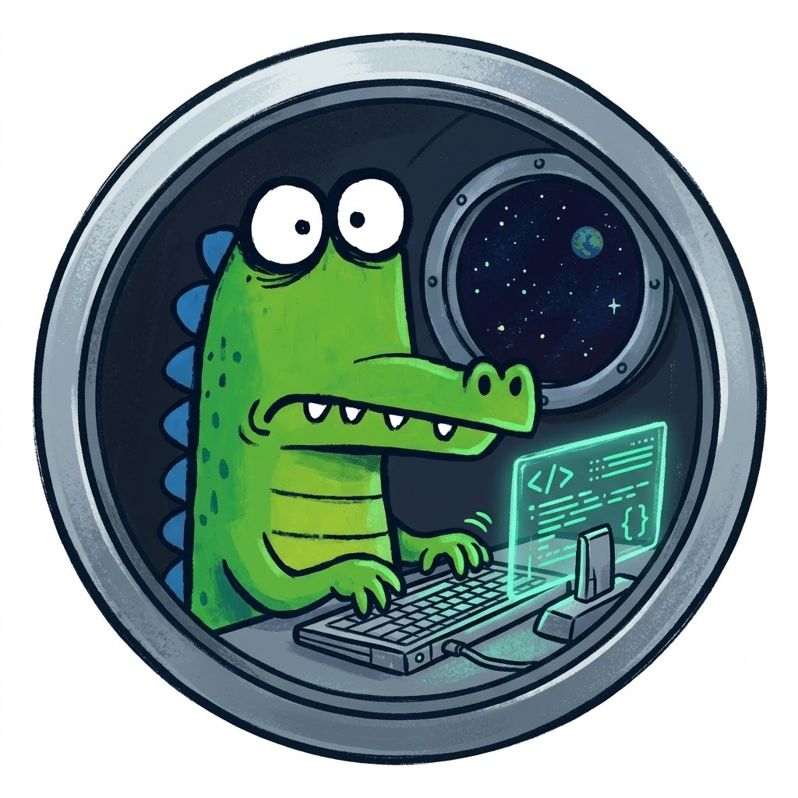
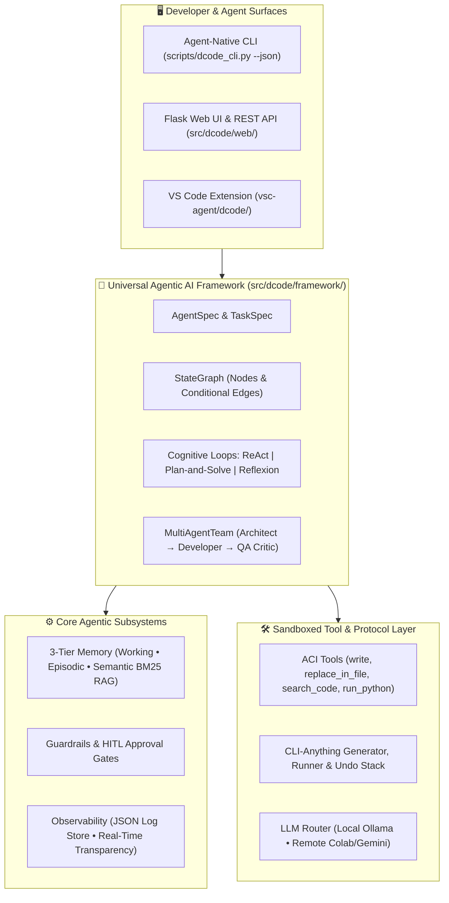

<div align="center">



# 🐊 Agent-DCODE

### **Universal Agentic AI Framework & Autonomous Software Engineering Platform**

*Local-First • Micro-Modular (`<100 Lines/File`) • Agent-Native CLI-Anything • Multi-Agent Swarms*

<p align="center">
  <a href="#-universal-agent-sdk--create-any-agent-in-10-lines"></a>
  <a href="#-micro-modular-repository-map"></a>
  <a href="#-cli-anything-agent-native-engine"></a>
  <a href="#-verification--benchmark-evals"></a>
</p>

<p align="center">
  
  
  
  
  
</p>

<p align="center">
  <a href="#-why-agent-dcode"><b>Why DCode?</b></a> •
  <a href="#-system-architecture"><b>Architecture</b></a> •
  <a href="#-universal-agent-sdk--create-any-agent-in-10-lines"><b>Agent SDK</b></a> •
  <a href="#-cli-anything-agent-native-engine"><b>CLI-Anything</b></a> •
  <a href="#-micro-modular-repository-map"><b>Folder Map</b></a> •
  <a href="docs/README.md"><b>Docs Hub (49 Guides)</b></a>
</p>

</div>

---

## 🌌 Why Agent-DCODE?

Most AI coding tools are either opaque SaaS wrappers or sprawling monoliths. **Agent-DCODE** is engineered from first principles as both a **production-ready Autonomous Coding Agent** and a **Universal Agentic AI Framework**—built under an extreme engineering discipline where **every single Python module is strictly `< 100 lines of code`**.

| Pillar | What It Does | Engineering Highlight |
| :--- | :--- | :--- |
| 🧠 **Pluggable Cognitive Loops** | Run **ReAct**, **Plan-and-Solve**, **Reflexion (Actor ↔ Critic)**, or **Multi-Agent Swarms** | Composable [`StateGraph`](src/dcode/framework/core/state_graph.py) DAG & cyclical state machine |
| 🛠️ **Universal `@tool` & ACI** | Turn any Python function into a JSON-Schema validated tool, plus surgical code editing | [`@tool`](src/dcode/framework/core/tool_decorator.py) type-hint introspection + [`replace_in_file`](src/dcode/tools/edit_tools.py) |
| ⚡ **CLI-Anything Engine** | Transforms codebases into **Agent-Native CLIs** with `--json`, `--dry-run`, `SKILL.md` & Undo | Modeled on **[HKUDS/CLI-Anything](https://github.com/HKUDS/CLI-Anything)** (*arXiv:2606.03854*) |
| 🗄️ **3-Tier Agent Memory** | **Working** (sliding window), **Episodic** (trajectory lessons), & **Semantic** (BM25 RAG) | Zero-dependency retrieval in [`src/dcode/memory/`](src/dcode/memory/) |
| 🛡️ **Guardrails & HITL** | Enforces step budgets, blocks path traversal / destructive shell commands, & gates high-risk calls | [`GuardrailPolicy`](src/dcode/guardrails/policy.py) & [`ApprovalGate`](src/dcode/guardrails/approval.py) |
| 🔭 **Live Transparency UI** | Real-time step, action, file-tree & progress streaming to the Web UI and VS Code Extension | [`TransparencyTracker`](src/dcode/observability/transparency_tracker.py) + 7 Flask Blueprints |

---

## 🏛️ System Architecture



---

## ⚡ Universal Agent SDK — Create *Any* Agent in 10 Lines

**Agent-DCODE** is a complete framework for building domain-specific agents—whether you need a **Site Reliability Engineer**, **Data Scientist**, **Security Auditor**, **Research Analyst**, or a **Multi-Agent Software Factory**.

### 1️⃣ Build a Custom Tool & ReAct Agent (`@tool` + `AgentSpec`)
```python
from dcode.framework import AgentSpec, ReActAgent, tool

@tool
def inspect_service_latency(service: str, window_min: int = 5) -> dict:
    """Fetch p99 latency and error rate telemetry for a microservice."""
    return {"service": service, "p99_ms": 42.8, "error_rate": 0.001, "status": "healthy"}

sre_agent = ReActAgent(
    AgentSpec(
        name="sre-sentinel",
        role="Site Reliability Engineering Agent",
        goal="Diagnose service latency and recommend automated remediations",
        tools=[inspect_service_latency],
        loop_type="react",
    )
)
result = sre_agent.run("Check telemetry for payment-service and report status")
```

### 2️⃣ Launch a 3-Agent Autonomous Software Team (`Architect → Developer → QA Critic`)
```python
from dcode.archetypes import create_software_team

team = create_software_team("autonomous-software-factory")
report = team.run("Design, implement, and verify a token-bucket rate limiter in projects/limiter.py")
```

### 3️⃣ Wire Custom Cyclical Workflows with `StateGraph`
```python
from dcode.framework import END, StateGraph

workflow = (
    StateGraph(entry_point="draft")
    .add_node("draft", lambda s: {**s, "attempt": s.get("attempt", 0) + 1, "ok": True})
    .add_node("verify", lambda s: {**s, "verified": s["ok"]})
    .add_edge("draft", "verify")
    .add_conditional_edges("verify", lambda s: END if s["verified"] else "draft")
)
final_state = workflow.run({})
```

---

## 🔧 CLI-Anything Agent-Native Engine

Inspired by **[HKUDS/CLI-Anything](https://github.com/HKUDS/CLI-Anything)** (*"Making ALL Software Agent-Native"*), DCode includes [`src/dcode/cli_anything/`](src/dcode/cli_anything/) to turn any Python module inside `projects/` into a self-describing CLI harness with deterministic `--json` output, `--dry-run`, `SKILL.md` discovery, and an automatic file **Undo/Redo snapshot stack**:

```bash
# 1. Auto-generate an Agent-Native CLI harness + SKILL.md from any file in projects/
python3 scripts/dcode_cli.py --generate-cli projects/calculator.py --json

# 2. Discover all registered CLI-Anything harnesses and SKILL.md manifests
python3 scripts/dcode_cli.py list-clis --json

# 3. Inspect stateful workspace session & trajectory history
python3 scripts/dcode_cli.py status --json

# 4. Instantly roll back the last file mutation from the snapshot stack
python3 scripts/dcode_cli.py undo --json
```

---

## 🗂️ Micro-Modular Repository Map (`100% < 100 Lines/File`)

Every Python module across the repository is strictly capped below 100 lines (largest file: **97 lines**):

```text
Agent-DCODE/
├── README.md                              # Portfolio overview & architectural guide
├── pyproject.toml                         # Package config & CLI entrypoints (dcode, dcode-orch, dcode-web)
├── requirements/                          # Dependency manifests (base.txt, colab.txt, dev.txt)
├── docs/                                  # 49 docs organized in 8 functional subfolders + assets/logo.jpg
│
├── src/dcode/                             # CORE AGENTIC AI FRAMEWORK & ENGINE (<100 lines/file)
│   ├── config.py                          # Centralized workspace paths, ports & LLM configuration
│   ├── framework/                         # 1. UNIVERSAL AGENT CREATION SDK
│   │   ├── core/                          # AgentSpec, @tool JSON-schema decorator, StateGraph, JSON loader
│   │   ├── loops/                         # ReActAgent & ReflexionAgent (Actor ↔ Critic)
│   │   └── swarm/                         # MultiAgentTeam sequential & supervisor handoffs
│   ├── memory/                            # 2. 3-TIER MEMORY (Working, Episodic, Semantic BM25 RAG)
│   ├── guardrails/                        # 3. SAFETY POLICIES & HUMAN-IN-THE-LOOP (HITL) GATES
│   ├── archetypes/                        # 4. PRE-BUILT TEMPLATES (Coder, Researcher, Analyst, DevOps, Security, Team)
│   ├── cli_anything/                      # 5. HKUDS/CLI-ANYTHING HARNESS GENERATOR, RUNNER & UNDO SESSION
│   ├── agents/                            # 6. AUTONOMOUS & CODEX CODING LOOPS (autonomous, codex, planner, verifier)
│   ├── tools/                             # 7. SANDBOXED ACI TOOLS (file, edit, code subprocess, system)
│   ├── llm/                               # 8. MODEL CLIENTS (Ollama, Gemini/Colab) & FENCE-AWARE JSON PARSER
│   ├── context/                           # 9. WORKSPACE CONTEXT EXTRACTORS & <2KB PROMPT BUILDER
│   ├── observability/                     # 10. STRUCTURED JSON LOGGER & LIVE TRANSPARENCY TRACKER
│   ├── orchestrator/                      # 11. LOCAL SERVICE HEALTH & PROCESS LIFECYCLE MANAGER
│   └── web/                               # 12. FLASK APP FACTORY, 7 ROUTE BLUEPRINTS & STATIC WEB UI
│
├── scripts/                               # CLI ENTRYPOINTS (dcode_cli.py, dcode_orchestrator.py, run_web.py)
├── tests/                                 # AUTOMATED UNIT TESTS (test_framework.py, test_tools_and_cli.py)
├── evals/                                 # BENCHMARK SUITE (run_evals.py, tasks.json)
├── releases/                              # Packaged VSIX binaries (agent-dcode-0.1.0.vsix)
├── vsc-agent/                             # TypeScript VS Code Extension
└── projects/                              # Sandboxed AI Workspace
```

---

## 🚀 Quick Start

```bash
# 1. Clone & install dependencies
git clone https://github.com/dr-week/Agent-DCODE.git
cd Agent-DCODE
python3 -m venv .venv && source .venv/bin/activate
pip install -r requirements/base.txt

# 2. Start Ollama & Flask Web UI via the Service Orchestrator
python3 scripts/dcode_orchestrator.py start

# Or launch the Flask Web UI directly on http://localhost:5000
python3 scripts/run_web.py
```

---

## 🧪 Verification & Benchmark Evals

Agent-DCODE ships with a zero-dependency unit test suite and an automated agent evaluation benchmark (`evals/`):

```bash
# Run Universal Framework Unit Tests (StateGraph, @tool, ReAct, Reflexion, Swarm, Memory, Guardrails)
python3 tests/test_framework.py -v

# Run Sandboxed ACI Tools & CLI-Anything Harness Tests
python3 tests/test_tools_and_cli.py -v

# Run Automated Agentic Evaluation Benchmark Suite (Code Gen, Surgical Refactor, CLI-Anything)
python3 evals/run_evals.py
```

| Benchmark Suite | Tasks / Assertions | Pass Rate | Latency |
| :--- | :--- | :---: | :---: |
| **Universal Agent Framework** (`tests/test_framework.py`) | `@tool` schema, `StateGraph`, `ReAct`, `Reflexion`, `Swarm`, 3-Tier Memory, Guardrails | **100% (5/5)** | `< 5 ms` |
| **Sandboxed Tools & CLI-Anything** (`tests/test_tools_and_cli.py`) | Fence JSON parser, `safe_path`, `replace_in_file`, `search_code`, CLI harness + Undo | **100% (4/4)** | `~30 ms` |
| **End-to-End Agent Evals** (`evals/run_evals.py`) | `task_01_fibonacci`, `task_02_surgical_refactor`, `task_03_cli_anything_harness` | **100% (3/3)** | `~60 ms` |

---

## 📚 Documentation Hub (8 Functional Categories)

Explore **[docs/README.md](docs/README.md)** for full architectural specifications and operational guides:

| Category | Directory | Key Documents |
| :--- | :--- | :--- |
| **01. Getting Started** | [`docs/01-getting-started/`](docs/01-getting-started/) | Quickstarts, 50+ Prompt Examples & Colab Setup |
| **02. Autonomous Engine** | [`docs/02-autonomous-engine/`](docs/02-autonomous-engine/) | Autonomous Loop Architecture & Integration |
| **03. Agents & Tools** | [`docs/03-agents-and-tools/`](docs/03-agents-and-tools/) | Codex Agent, Control Bar, 10 Actions & Logging |
| **04. Transparency & UI** | [`docs/04-transparency-and-ui/`](docs/04-transparency-and-ui/) | Real-Time Transparency & File Panel Guides |
| **05. Orchestrator & Ops** | [`docs/05-orchestrator-and-ops/`](docs/05-orchestrator-and-ops/) | Service Lifecycle Manager & Health Checks |
| **06. VS Code Extension** | [`docs/06-vscode-extension/`](docs/06-vscode-extension/) | Extension Guide, Process Manager & Debugging |
| **07. Testing & QA** | [`docs/07-testing-and-verification/`](docs/07-testing-and-verification/) | Verification Checklists & Web UI Test Scenarios |
| **08. Releases & Logs** | [`docs/08-releases-and-reports/`](docs/08-releases-and-reports/) | Release Notes (`v0.1.0` – `v1.3.0`) & Project Logs |

---

<div align="center">
  <b>Built for the Agentic AI Era 🐊✨</b><br/>
  <sub>MIT Licensed • Local-First • Agent-Native</sub>
</div>
