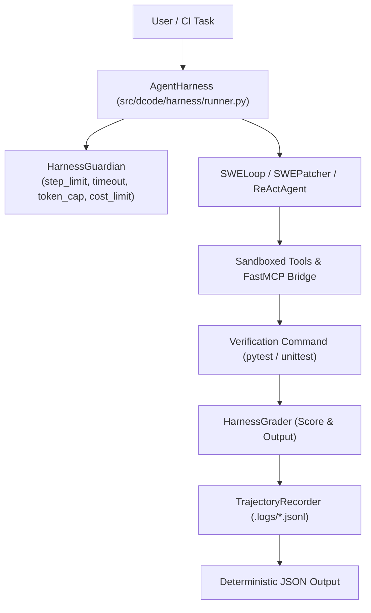

# AI Agent Harness Architecture & Development Guide (`src/dcode/harness/`)

## 1. Overview: The Harness Paradigm

In modern agentic AI engineering (2025-2026), **the model is a commodity; the harness is the actual product capability**.

An **Agent Harness** is the runtime scaffolding that wraps an LLM and cognitive loops to provide:
1. **Safety Boundaries & Budgets:** Hard ceilings on execution steps, turn timeouts, token budgets, and USD costs.
2. **Context & RepoMap Injection:** Upfront workspace inspection (AST symbols, git status, environment facts) before the agent acts.
3. **Trajectory Recording:** Append-only JSONL execution journals capturing step inputs, tool calls, diffs, tokens, and latency for exact replay.
4. **Deterministic Grading:** Objective evaluation against test commands, string assertions, and diff criteria.

---

## 2. Architecture Diagram



---

## 3. Configuration Contract (`HarnessConfig`)

Defined in `src/dcode/harness/config.py`:

```python
from dcode.harness import AgentHarness, HarnessConfig

config = HarnessConfig(
    max_steps=5,                    # Hard cap on iterations
    step_timeout_sec=30.0,          # Per-step timeout trap
    token_budget=25000,             # Max cumulative tokens
    cost_limit_usd=0.50,            # Max USD spending cap
    auto_rollback_on_fail=True,     # Revert workspace if test fails
    workspace_dir="/path/to/repo",  # Target codebase
    test_command="pytest",          # Automated verification command
    trajectory_file=".logs/run.jsonl" # Append-only trace output
)

harness = AgentHarness(config)
result = harness.execute_swe_task("Fix discount percentage bug")
```

---

## 4. Trajectory Ledger Schema

Every step is logged to `.logs/trajectory_<timestamp>.jsonl`:

```json
{
  "step": 1,
  "timestamp": 1795074872.45,
  "action": "swe_fix",
  "input": "Fix discount percentage bug",
  "output": "PASSED",
  "diff_lines": 6,
  "tokens": 100,
  "cost_usd": 0.001,
  "latency_ms": 89.2,
  "status": "ok"
}
```

---

## 5. Development & Code Quality Scripts (`scripts/`)

Agent-DCODE provides 3 core developer scripts for repository maintenance:

| Script | Command | Purpose |
| :--- | :--- | :--- |
| **Modularity Enforcer** | `python3 scripts/check_modularity.py` | Audits all 104+ Python files across `src/`, `scripts/`, `tests/`, and `evals/`. Enforces the strict `< 100 lines` limit and lists files approaching the limit (>85L). |
| **Developer Quality Gate** | `python3 scripts/dev_check.py` | One-command pre-commit check: runs modularity audit, all 20 unit tests, and the 5-task SWE evals in ~1 second. |
| **Agent Harness CLI Runner** | `python3 scripts/run_harness.py "<task>" [options]` | Runs any agent or SWE loop inside a guarded harness with custom budget limits, timeout traps, and trajectory export. |

---

## 6. CLI Usage Examples

```bash
# Run a task inside the budget-guarded harness
python3 scripts/dcode_cli.py harness "Fix pricing discount bug" \
  --dir /path/to/workspace \
  --test-cmd "pytest" \
  --max-attempts 3 \
  --json

# Run the dedicated Harness runner with a custom token budget and trajectory file
python3 scripts/run_harness.py "Implement user auth route" \
  --max-steps 5 \
  --token-budget 15000 \
  --cost-limit 0.25 \
  --trajectory-out .logs/auth_task.jsonl \
  --json

# Run all quality checks before pushing code
python3 scripts/dev_check.py
```
