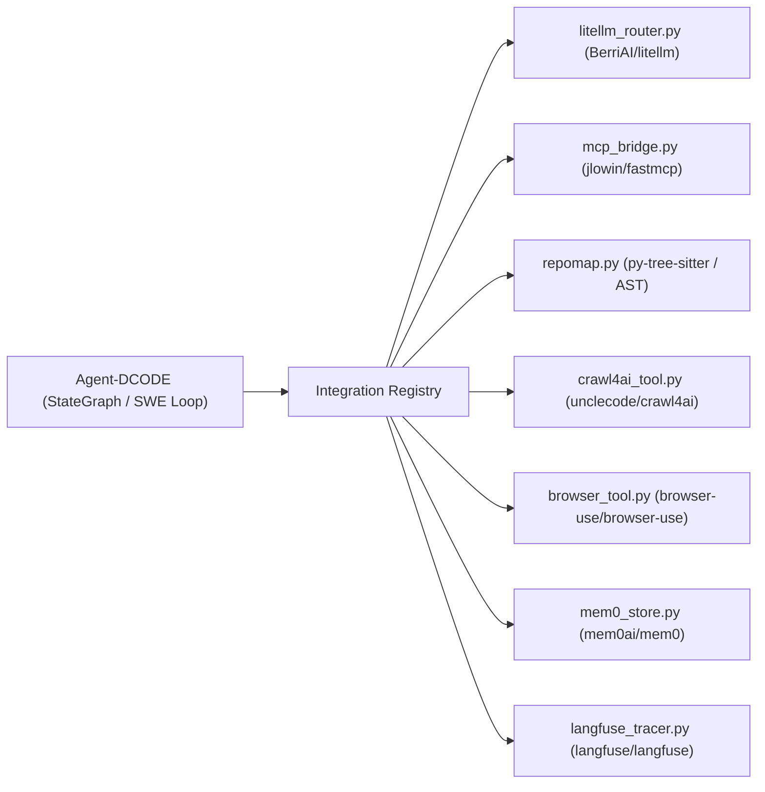

# Open-Source GitHub Integrations Guide (`src/dcode/integrations/`)

Agent-DCODE uses a **plug-and-play micro-adapter architecture**. Rather than writing monolithic custom wrappers, each external open-source project is encapsulated in a single `< 100-line` file under `src/dcode/integrations/` with an automatic zero-dependency fallback so tests and offline workflows never break.

---

## 1. Architecture Pattern



Every adapter implements two guarantees:
1. **Strict `< 100 Lines` Modularity:** Each adapter file is self-contained and under 100 lines of Python.
2. **Graceful Degradation:** If the optional upstream pip package is not installed, the adapter falls back to a built-in stdlib engine (e.g., `urllib.request`, Python `ast`, or local SQLite/JSON) and reports its status via `get_integration_status()`.

---

## 2. Installation Matrix

Install only the tiers you need, or install the full next-level stack at once:

```bash
# Core + Phase 1 (100+ LLMs + MCP Tool Protocol)
pip install litellm fastmcp

# Phase 2 (Multi-language AST RepoMap)
pip install tree-sitter

# Phase 3 (Live Web Crawling + Headless Browser Automation)
pip install crawl4ai browser-use playwright && playwright install chromium

# Phase 4 (Persistent Agent Memory + LLM Tracing)
pip install mem0ai langfuse
```

---

## 3. Module Reference by Phase

### Phase 1: `litellm_router.py` & `mcp_bridge.py`
- **Upstream Repos:** [`BerriAI/litellm`](https://github.com/BerriAI/litellm), [`jlowin/fastmcp`](https://github.com/jlowin/fastmcp)
- **What They Solve:**
  - `LiteLLMRouter` lets any agent switch seamlessly between `ollama/qwen2.5-coder:7b`, `openai/gpt-4o`, `anthropic/claude-3-7-sonnet`, or `gemini/gemini-2.5-pro` using a single `complete(prompt, model=...)` method with automatic fallback to local Ollama.
  - `MCPBridge` exposes Agent-DCODE's tools (`read_file`, `replace_in_file`, `search_code`, `cli_anything`) as an MCP server and loads external MCP tools into DCODE agents.

### Phase 2: `repomap.py`, `git_checkpoint.py` & `swe_loop.py`
- **Upstream Repos:** [`tree-sitter/py-tree-sitter`](https://github.com/tree-sitter/py-tree-sitter), [`SWE-agent/mini-swe-agent`](https://github.com/SWE-agent/mini-swe-agent)
- **What They Solve:**
  - `RepoMap` scans a codebase and extracts a compact map of classes, functions, and signatures so the agent knows where every symbol lives before editing.
  - `GitCheckpoint` creates automatic rollback points before edits and produces clean unified diffs.
  - `SWELoop` combines `RepoMap` + `GitCheckpoint` + `pytest` verification into an autonomous **Issue-to-PR** solver.

### Phase 3: `crawl4ai_tool.py` & `browser_tool.py`
- **Upstream Repos:** [`unclecode/crawl4ai`](https://github.com/unclecode/crawl4AI), [`browser-use/browser-use`](https://github.com/browser-use/browser-use)
- **What They Solve:**
  - `crawl_url` converts any documentation URL, GitHub issue, or changelog into clean LLM-friendly Markdown.
  - `browser_verify` launches a headless browser to interact with a live web app, check DOM elements, and capture console errors for self-healing UI repairs.

### Phase 4: `mem0_store.py` & `langfuse_tracer.py`
- **Upstream Repos:** [`mem0ai/mem0`](https://github.com/mem0ai/mem0), [`langfuse/langfuse`](https://github.com/langfuse/langfuse)
- **What They Solve:**
  - `Mem0Store` stores long-term semantic memories across sessions (coding style, project conventions, recurring root causes).
  - `LangfuseTracer` records nested spans for every `StateGraph` step, tracking token usage, cost in USD, and latency.
