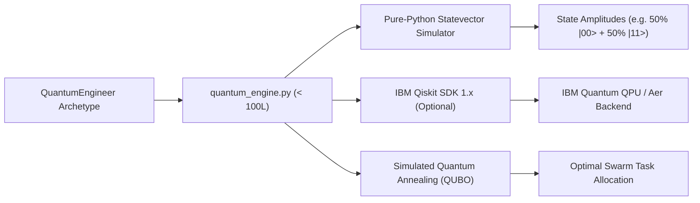

# Quantum Mechanics Engine & Qiskit SDK Integration (`src/dcode/integrations/quantum_engine.py`)

## 1. Overview: Quantum-Augmented Agentic Systems

In 2026, **Agentic AI meets Quantum Computing** (*arXiv:2506.01536* and *arXiv:2602.19387*). Agent-DCODE integrates quantum mechanics through two complementary mechanisms:
1. **Quantum Circuit Synthesis & Simulation:** An autonomous `QuantumEngineer` archetype that designs, transpiles, and simulates quantum algorithms using IBM's Qiskit SDK or a built-in statevector simulator.
2. **Quantum-Inspired Swarm Task Scheduling (QUBO):** Combinatorial task assignment across multi-agent swarms formulated as Quadratic Unconstrained Binary Optimization solved via Simulated Quantum Annealing.

---

## 2. Micro-Modular Architecture



---

## 3. Supported Quantum Gates & Operations

The zero-dependency statevector engine supports up to 10 qubits with exact complex amplitude calculation:

| Gate | Symbol | Operation | Physical Significance |
| :--- | :--- | :--- | :--- |
| **Hadamard** | $H$ | $|0\rangle \to \frac{|0\rangle + |1\rangle}{\sqrt{2}}$ | Puts a classical bit into equal quantum superposition. |
| **Pauli-X** | $X$ | $|0\rangle \to |1\rangle$, $|1\rangle \to |0\rangle$ | Quantum bit-flip gate (NOT gate). |
| **Controlled-NOT** | $CNOT$ | $|00\rangle \to |00\rangle$, $|10\rangle \to |11\rangle$ | Creates quantum entanglement between control and target qubits. |

---

## 4. CLI Usage Examples

```bash
# 1. Simulate a 2-qubit Bell State (|Phi+> = (|00> + |11>) / sqrt(2))
python3 scripts/dcode_cli.py quantum --json

# 2. Inspect Quantum Tools exposed in the MCP tool bus
python3 scripts/dcode_cli.py mcp-tools --json

# 3. Inspect Quantum SDK integration status
python3 scripts/dcode_cli.py integrations --json
```

---

## 5. Python SDK Usage

```python
from dcode.integrations import simulate_quantum_circuit, quantum_optimize_qubo

# Simulate a Bell State
result = simulate_quantum_circuit(
    num_qubits=2,
    gates=[
        {"gate": "H", "qubit": 0},
        {"gate": "CNOT", "control": 0, "target": 1}
    ]
)
print(result["probabilities"])  # {"00": 0.5, "11": 0.5}

# Solve task allocation via Simulated Quantum Annealing (QUBO)
cost_matrix = [[-2.0, 1.0], [1.0, -2.0]]
schedule = quantum_optimize_qubo(cost_matrix)
print(schedule["optimal_bitstring"])
```
